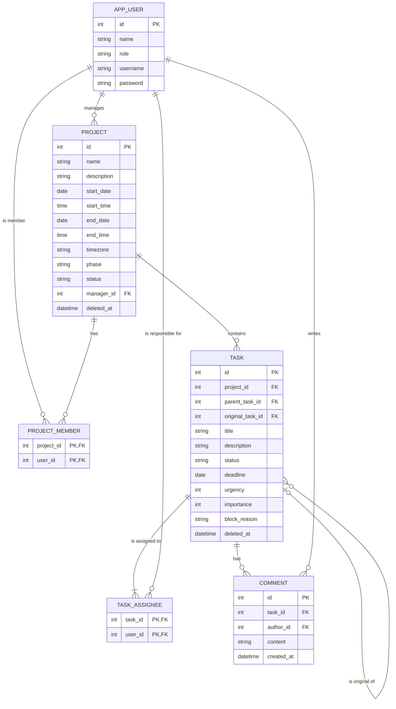

# Matriz — Modelo de dados

> Modelo lógico dos dados essenciais do MVP (v1), com o diagrama entidade-relacionamento em Mermaid. Não escolhe base de dados nem tecnologias: isso continua em T2 e T7 ([constraints.md](constraints.md#4-decisões-técnicas-pendentes)).
> Documentos relacionados: [requirements.md](requirements.md), [user-stories.md](user-stories.md), [constraints.md](constraints.md) e [architecture.md](architecture.md).

## 1. Âmbito e convenções

- **Âmbito:** só a v1 (F01 a F10, F17 e F22). O que a v2 e a v3 acrescentam está na secção 8 e não entra no diagrama.
- **Origem:** o modelo sai da secção 3.1 de [requirements.md](requirements.md#31-informação-gerida) e das regras R1 a R26. Tudo o que o modelo acrescenta e não está documentado fica na secção 7, como ponto **por confirmar** (códigos **M1 a M10**, locais a este documento).
- **Nomes:** as entidades e os atributos estão em inglês, como a interface (NF01). A tabela da secção 2 faz a correspondência com os termos em português. Os valores dos domínios usam os rótulos da interface ([requirements.md](requirements.md#34-termos-da-interface)). A escolha de nomes é uma proposta.
- **Identificadores:** cada entidade tem um identificador interno (`id`). As tabelas de associação usam como identificador o par de chaves das duas entidades que ligam (M9).
- **Módulos:** cada entidade pertence a um módulo de [architecture.md](architecture.md#4-componentes-e-responsabilidades) e só esse módulo a altera.

## 2. Entidades

| Entidade | Termo em português | O que representa | Módulo | Origem |
|---|---|---|---|---|
| `APP_USER` | Utilizador | Pessoa que usa a aplicação: membro da equipa ou gestor de projeto | Acesso e Visibilidade | Secção 3.1, P21 |
| `PROJECT` | Projeto | Projeto com datas, fase e estado, e o seu gestor | Projetos e Equipas | F01, R16, R19 |
| `PROJECT_MEMBER` | Equipa | Associação entre um projeto e cada um dos seus membros. Não existe entidade "equipa" (P2) | Projetos e Equipas | F01, R11 |
| `TASK` | Tarefa e subtarefa | Tarefa principal ou subtarefa. Uma subtarefa é uma tarefa com tarefa-mãe (M1) | Tarefas | F02, F03, F08 |
| `TASK_ASSIGNEE` | Responsáveis | Associação entre uma tarefa (ou subtarefa) e cada um dos seus responsáveis | Tarefas | F02, R21 |
| `COMMENT` | Comentário | Texto escrito por um utilizador numa tarefa, com autor e data de criação | Tarefas | F17, R24 |

A reciclagem (F09) não tem entidade própria: `PROJECT` e `TASK` têm a marca `deleted_at` (M4). A sessão do utilizador (F10) não se guarda neste modelo: o mecanismo é decisão técnica (T3). Os comentários não têm marca de apagado própria: seguem a da tarefa (R24).

## 3. Atributos

**Legenda:** *Obr.* = obrigatório. Os tipos são lógicos (texto, inteiro, data, hora, data e hora), não de uma base de dados concreta.

### 3.1 `APP_USER`

| Atributo | Tipo | Obr. | Notas |
|---|---|---|---|
| `id` | inteiro | Sim | Identificador |
| `name` | texto | Sim | Nome do utilizador |
| `username` | texto | Sim | Identificador de início de sessão; único (M11) |
| `password` | texto | Sim | Credencial da conta de demonstração, guardada de forma protegida; o mecanismo é decisão técnica (T3, M11) |
| `role` | texto | Sim | `Team member` ou `Project manager`. Atributo do utilizador, não do projeto (secção 3.1 de requirements) |

### 3.2 `PROJECT`

| Atributo | Tipo | Obr. | Notas |
|---|---|---|---|
| `id` | inteiro | Sim | Identificador |
| `name` | texto | Sim | Máximo 100 caracteres (R14, P17) |
| `description` | texto | Não | Máximo 2000 caracteres (R14, P17). Se é obrigatória, não está definido (M7) |
| `start_date` | data | Sim | R16 |
| `start_time` | hora | Não | Sem hora, conta a partir das 00:00 (P26, por validar) |
| `end_date` | data | Sim | R16 |
| `end_time` | hora | Não | Sem hora, o dia de fim conta inteiro (P26, por validar) |
| `timezone` | texto | Sim | Fuso horário do projeto; por defeito, o de Lisboa (P26, por validar) |
| `phase` | texto | Sim | `Initiation`, `Planning`, `Execution`, `Monitoring` ou `Evaluation` (P3) |
| `status` | texto | Sim | Só os estados definidos pelo gestor: `Not started`, `In progress`, `Suspended` ou `Completed`. `Attention` e `Late` não se guardam (secção 6, P5, R12) |
| `manager_id` | inteiro | Sim | Chave para `APP_USER`. Um só gestor por projeto, indicado por quem cria o projeto (R19) |
| `deleted_at` | data e hora | Não | Vazio = não apagado. Apagado há mais de 30 dias é eliminado (R20, M4) |

### 3.3 `PROJECT_MEMBER`

| Atributo | Tipo | Obr. | Notas |
|---|---|---|---|
| `project_id` | inteiro | Sim | Chave para `PROJECT`; parte do identificador |
| `user_id` | inteiro | Sim | Chave para `APP_USER`; parte do identificador |

A linha mantém-se quando o projeto é concluído ou suspenso (P20, P22). O gestor do projeto não precisa de linha neste projeto (M5).

### 3.4 `TASK`

| Atributo | Tipo | Obr. | Notas |
|---|---|---|---|
| `id` | inteiro | Sim | Identificador |
| `project_id` | inteiro | Sim | Chave para `PROJECT`. Uma subtarefa fica no projeto da tarefa-mãe |
| `parent_task_id` | inteiro | Não | Chave para `TASK`. Vazio = tarefa principal; preenchido = subtarefa (M1) |
| `title` | texto | Sim | Máximo 100 caracteres (R14) |
| `description` | texto | Não | Máximo 2000 caracteres (R14, M7) |
| `status` | texto | Sim | `To do`, `In progress`, `In review`, `Blocked`, `Done`, `Cancelled` ou `Duplicate`. Os três últimos são finais |
| `deadline` | data | Sim | R1. Se tem hora, não está definido (M3) |
| `urgency` | inteiro | Sim | 1 a 4: Low, Medium, High, Critical (F03) |
| `importance` | inteiro | Sim | 1 a 4: Low, Medium, High, Critical (F03) |
| `block_reason` | texto | Só se `Blocked` | R6. O limite de tamanho não está definido (M8) |
| `original_task_id` | inteiro | Só se `Duplicate` | Chave para `TASK`: a tarefa original, escolhida à mão (R6) |
| `deleted_at` | data e hora | Não | Vazio = não apagada (R9, R20, M4) |

### 3.5 `TASK_ASSIGNEE`

| Atributo | Tipo | Obr. | Notas |
|---|---|---|---|
| `task_id` | inteiro | Sim | Chave para `TASK`; parte do identificador |
| `user_id` | inteiro | Sim | Chave para `APP_USER`; parte do identificador |

Uma tarefa pode ter vários responsáveis, e uma subtarefa tem os seus próprios (F02, secção 3.1). Há sempre pelo menos um (R26).

### 3.6 `COMMENT`

| Atributo | Tipo | Obr. | Notas |
|---|---|---|---|
| `id` | inteiro | Sim | Identificador |
| `task_id` | inteiro | Sim | Chave para `TASK` |
| `author_id` | inteiro | Sim | Chave para `APP_USER`: quem escreveu, atribuído pela aplicação (R24) |
| `content` | texto | Sim | Máximo 2000 caracteres, texto simples (R24, P28, NF09) |
| `created_at` | data e hora | Sim | Atribuída pela aplicação; mantém-se quando o comentário é editado (R24) |

## 4. Relacionamentos e cardinalidades

| # | Relacionamento | Cardinalidade | Leitura | Origem |
|---|---|---|---|---|
| 1 | `APP_USER` gere `PROJECT` | 1 : N | Cada projeto tem exatamente um gestor; um utilizador pode gerir zero ou vários projetos | R19, P2 |
| 2 | `PROJECT` tem `PROJECT_MEMBER` | 1 : N | Um projeto tem zero ou mais membros (começa sem membros e o gestor adiciona-os) | F01 |
| 3 | `APP_USER` aparece em `PROJECT_MEMBER` | 1 : N | Um utilizador pode estar associado a vários projetos ao longo do tempo | R11, P20 |
| 4 | `PROJECT` contém `TASK` | 1 : N | Uma tarefa pertence a exatamente um projeto; um projeto tem zero ou mais tarefas | F02 |
| 5 | `TASK` tem subtarefas (`TASK`) | 0..1 : N | Uma subtarefa tem uma só tarefa-mãe; uma tarefa tem zero ou mais subtarefas | F08 |
| 6 | `TASK` é original de `TASK` | 0..1 : N | Uma tarefa duplicada indica uma só original; uma tarefa pode ser a original de várias duplicadas | R6 |
| 7 | `TASK` tem `TASK_ASSIGNEE` | 1 : 1..N | Uma tarefa tem um ou mais responsáveis (a aplicação garante o "pelo menos um", R26) | F02, R26 |
| 8 | `APP_USER` aparece em `TASK_ASSIGNEE` | 1 : N | Um utilizador pode ser responsável por várias tarefas | F02, P25 |
| 9 | `TASK` tem `COMMENT` | 1 : N | Uma tarefa tem zero ou mais comentários; cada comentário pertence a uma só tarefa | F17 |
| 10 | `APP_USER` escreve `COMMENT` | 1 : N | Um utilizador escreve zero ou mais comentários; cada comentário tem exatamente um autor | F17, R24 |

**Relações muitos-para-muitos:** utilizador ↔ projeto (membros) e utilizador ↔ tarefa (responsáveis). Resolvem-se com `PROJECT_MEMBER` e `TASK_ASSIGNEE`.

## 5. Diagrama ER

O diagrama mostra só entidades, chaves, atributos e relacionamentos. Os domínios, os limites e as condições de cada atributo estão nas tabelas da secção 3.

> **Note:** "has subtasks" and "is original of" link `TASK` to itself. They are stored in `parent_task_id` (parent task) and `original_task_id` (original task).

## 6. Regras de negócio e dados derivados

### 6.1 O que o modelo garante e o que a aplicação valida

O modelo só expressa a estrutura. As regras que comparam várias linhas ou dependem de estados são validadas pela aplicação (nos módulos e nos casos de uso de [architecture.md](architecture.md#4-componentes-e-responsabilidades)), numa só transação.

| Regras | Como ficam cobertas |
|---|---|
| R1, R16, R19, R14 | **Modelo:** campos obrigatórios (`deadline`, datas do projeto, `manager_id`) e tamanhos máximos. R16 (fim posterior ao início) é validada pela aplicação |
| R2, R3, R13 | **Aplicação:** comparam o `deadline` da subtarefa com o da tarefa-mãe e com a data atual |
| R4, R5, R9 (tarefa-mãe com subtarefas em aberto) | **Aplicação:** consultam o `status` das subtarefas (`parent_task_id`) |
| R6 | **Modelo:** `block_reason` e `original_task_id` existem. **Aplicação:** são obrigatórios nos estados `Blocked` e `Duplicate`; a original é do mesmo projeto, diferente da própria e não está em `Duplicate` |
| R8, R12, R9 (permissões), R19 (visibilidade) | **Aplicação**, no módulo Acesso e Visibilidade, a partir de `role`, `manager_id` e `PROJECT_MEMBER` |
| R11 | **Aplicação.** Não pode ser uma restrição do modelo, porque depende do `status` do projeto e porque o P22 permite, de forma excecional, um membro em dois projetos em aberto |
| R17 | **Aplicação:** remove a linha de `PROJECT_MEMBER` e passa as tarefas por concluir para o novo membro (`TASK_ASSIGNEE`), numa só transação |
| R21 | **Aplicação:** cada `TASK_ASSIGNEE` tem de ser membro do projeto da tarefa ou o seu gestor |
| R22 | **Aplicação:** ao criar uma tarefa, o `status` do projeto não pode ser `Completed` nem `Suspended` |
| R24 | **Modelo:** `content` até 2000 caracteres; `author_id` e `created_at` obrigatórios. **Aplicação:** só quem tem acesso ao projeto comenta, atribui autor e data, só o autor edita ou apaga (apagar elimina a linha), nada disto num projeto `Completed`, e os comentários seguem o `deleted_at` da tarefa |
| R26 | **Aplicação:** cada tarefa mantém pelo menos uma linha em `TASK_ASSIGNEE`; remover a última é recusado |
| R20, R9 | **Modelo:** `deleted_at`. **Aplicação:** apagar um projeto marca também as suas tarefas, recuperar desfaz, e a eliminação definitiva corre ao fim de 30 dias |
| R18, R15, R23, R25 | **Consultas de leitura:** só tarefas principais (`parent_task_id` vazio), ordenadas por `deadline`, depois `urgency` e `importance`; filtros por `status` e por quadrante; pesquisa de projetos por `name` |

R7 e R10 pertencem à v2 (secção 8).

### 6.2 Dados que não se guardam (derivados)

Calculam-se sempre a partir dos dados acima, para nunca ficarem desatualizados.

| Dado | Calculado a partir de | Origem |
|---|---|---|
| Estados `Attention` e `Late` do projeto | `start`, `end`, `timezone`, `status = In progress` e o progresso | P5, R12 |
| Progresso e etiqueta "sem tarefas" | Tarefas principais por estado | P7, P16, R18 |
| Projeto em aberto | `status` diferente de `Completed` e `Suspended` (e de arquivado, na v2) | P4 |
| Etiqueta vermelha do membro | Membro de um projeto retomado e, ao mesmo tempo, de outro projeto em aberto | P22, R11 |
| Tarefa em estado final | `status` em `Done`, `Cancelled` ou `Duplicate` | Secção 3.1 |
| Quadrante da Matriz | `urgency` e `importance` (1 e 2 = baixo; 3 e 4 = alto) | Secção 3.2 |
| Data de eliminação definitiva | `deleted_at` + 30 dias | R20 |
| Contagens de tarefas por estado no painel inicial | `status` das tarefas principais de cada projeto acessível | F07, R18, P27 |
| "Prioridade" usada nos filtros | Quadrante, a partir de `urgency` e `importance` | R25 |

## 7. Pontos por confirmar

Decisões de modelação que não estão documentadas e escolhas que dependem de pressupostos ainda por validar. O código **M** é local a este documento.

| ID | Ponto | Proposta usada no modelo | Estado |
|---|---|---|---|
| M1 | Uma subtarefa pode ter subtarefas? | Não: um só nível. Subtarefa e tarefa partilham a entidade `TASK`, e a subtarefa tem `parent_task_id`. A documentação fala em tarefa-mãe e subtarefas, sem definir mais níveis | Por confirmar |
| M2 | Datas e horas do projeto | `start_time` e `end_time` opcionais, e `timezone` obrigatório com o de Lisboa por defeito. Depende de P23 e P26 | Por validar (P23, P26) |
| M3 | O prazo da tarefa tem hora? | Só data. R13 fala em "prazo igual à data atual", e P26 só dá hora à data de fim do projeto | Por confirmar |
| M4 | Como se guarda a reciclagem | Uma marca `deleted_at` em `PROJECT` e `TASK`, em vez de uma entidade própria. Fica em aberto: se uma tarefa apagada à mão antes do projeto volta quando o projeto é recuperado, e se uma subtarefa se recupera depois de a tarefa-mãe ser eliminada (já é questão em aberto em [constraints.md](constraints.md#questões-funcionais-em-aberto)) | Por confirmar |
| M5 | O gestor é membro do seu projeto? | Não precisa de linha em `PROJECT_MEMBER` no seu projeto: é referido por `manager_id` (R21 diz "membros do projeto ou o seu gestor"). Em projetos de outros gestores, é adicionado como membro (R19) | Por confirmar |
| M6 | Uma tarefa tem de ter pelo menos um responsável? | Sim, sempre pelo menos um (R26) | Decisão |
| M7 | Que campos de texto são obrigatórios? | Só são obrigatórios o nome do projeto e o título da tarefa. As descrições são opcionais. Os requisitos só tornam obrigatórios o prazo (R1) e as datas do projeto (R16) | Por confirmar |
| M8 | Limite do motivo de bloqueio | Não está definido. R14 só limita título e descrição | Por confirmar |
| M9 | Identificadores | Identificador interno em cada entidade e par de chaves nas tabelas de associação. Nome de projeto e de utilizador não são únicos, porque nada o exige | Proposta |
| M10 | Papel do utilizador | `role` é um só e global. Um utilizador `Team member` não pode ser indicado como gestor. A documentação diz que o gestor é indicado por quem cria o projeto, sem dizer se tem de ter esse papel | Por confirmar |
| M11 | Credenciais da conta | `username` único e `password` obrigatória em `APP_USER`. O novo âmbito não define o identificador de início de sessão (nome de utilizador, email) nem as regras da palavra-passe (S5) | Por confirmar |
| M12 | Comentários | Entidade `COMMENT` ligada a `TASK` e a `APP_USER`, sem marca de apagado própria (seguem a tarefa). Editar altera `content` e mantém `created_at`; apagar elimina a linha, sem histórico de edições | Decisão (P28) |

**Dependem também de pressupostos por validar:** P23 e P26 (datas do projeto).

**Não modelado por não estar definido:** ligação das tarefas a uma fase do projeto (questão em aberto em [constraints.md](constraints.md#questões-funcionais-em-aberto)). A ordem das tarefas (R23) não se guarda: resulta de `deadline`, `urgency` e `importance`.

## 8. Evolução prevista (v2 e v3)

Fora do diagrama. Indicam-se só as alterações previsíveis, sem as modelar.

| Versão | Funcionalidade | Impacto no modelo |
|---|---|---|
| v2 | Criação de contas pelo gestor (F23), P13 | `APP_USER` deixa de vir só de seed. A saída de utilizadores segue o P13 |
| v2 | Etiquetas (F11) | Nova entidade ligada a `TASK` |
| v2 | Lembretes e alertas (F12), R7 | Dados de lembrete por tarefa e configuração de alertas |
| v2 | Arquivo (F13), R10 | Novo valor em `PROJECT` (arquivado) e histórico guardado |
| v2 | Auditoria (F14), P14 | Nova entidade de registo: quem, o quê e quando |
| v3 | Anexos (F16) | Nova entidade ligada a `TASK` |
| v3 | Registo de tempo, tarefas repetidas, modelos (F20) | Fora de âmbito por agora |

## 9. Revisão de coerência

| Verificação | Resultado |
|---|---|
| Cada funcionalidade da v1 usa entidades do modelo: F01 (`PROJECT`, `PROJECT_MEMBER`), F02 e F03 (`TASK`, `TASK_ASSIGNEE`), F04, F05 e F07 (consultas sobre `TASK` e `PROJECT`), F06 (`APP_USER`, `PROJECT.manager_id`, `PROJECT_MEMBER`), F08 (`TASK.parent_task_id`), F09 (`deleted_at`), F10 (`APP_USER.username` e `password`), F17 (`COMMENT`), F22 (consultas por `name`, `status`, `urgency` e `importance`) | Coberto |
| Cada atributo do projeto e da tarefa descritos em [requirements.md](requirements.md#31-informação-gerida) existe no modelo, exceto etiquetas e lembrete (v2) | Coberto |
| Estados e fases do projeto e da tarefa coincidem com a secção 3.4 de requirements; `Attention` e `Late` não são guardados | Coerente com P5 e R12 |
| Cada relacionamento tem cardinalidade e leitura (secção 4), e as duas relações muitos-para-muitos estão resolvidas | Coberto |
| O diagrama usa as mesmas entidades, atributos e chaves das tabelas das secções 2 e 3 | Coerente |
| Nenhuma tecnologia foi escolhida | Coerente com T2 e T7 |
