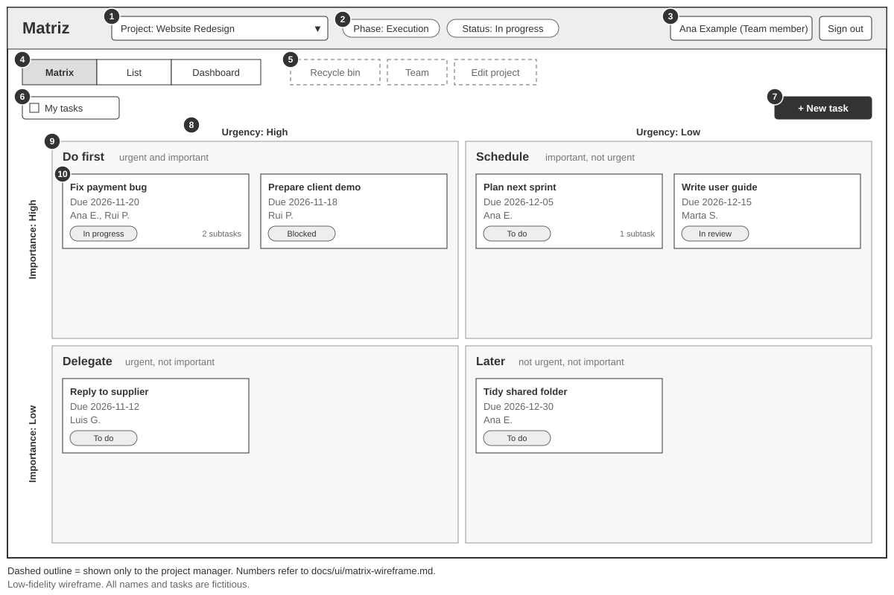

# Matriz — Wireframe do separador Matrix

> Wireframe de baixa fidelidade da vista **Matrix** de um projeto (F04), que é o separador *Matrix* do detalhe do projeto. Usa a mesma barra superior, caminho, cabeçalho e separadores dos outros ecrãs, descritos em [wireframes.md](wireframes.md). Não define estilo visual nem tecnologia.
> Documentos relacionados: [requirements.md](../requirements.md), [user-stories.md](../user-stories.md) e [constraints.md](../constraints.md).

## 1. Ecrã

A **vista Matrix** é a vista principal da Matriz ([requirements.md](../requirements.md#32-vistas)). Mostra as tarefas principais de um projeto por urgência e importância. Chega-se a ela pelo painel inicial ou pela lista de projetos, e o separador *List* mostra as mesmas tarefas em tabela ([wireframes.md](wireframes.md#4-detalhe-do-projeto-f01-f02-f05-f22-us01-us02-us09-us12)).

**Como foi gerado:** desenhado com IA (Claude) a partir dos documentos deste repositório, em SVG de baixa fidelidade, sem cores nem estilo. Os rótulos estão em inglês, como a interface (NF01). Os nomes e as tarefas são fictícios (C8).

## 2. Wireframe

Ficheiro: [matrix-wireframe.svg](matrix-wireframe.svg). Os números do desenho correspondem aos da tabela seguinte. Os elementos de contorno tracejado só aparecem ao gestor do projeto, e não num projeto concluído.

## 3. Elementos do ecrã

| # | Elemento | O que mostra | Origem |
|---|---|---|---|
| 1 | Caminho | *Projects / nome do projeto* | Navegação |
| 2 | Dados do projeto | Nome, descrição, fase, estado, datas com fuso horário, gestor e equipa | F01 |
| 3 | *Edit project*, *Team* e *Delete project* (só gestor) | Editar os dados, gerir a equipa e eliminar. Não aparecem num projeto concluído | F01, R9, R28 |
| 4 | Separadores *Matrix* e *List* | *Matrix* está ativo | F04, F05 |
| 5 | Filtro *My tasks* | Mostra a tarefa principal se o utilizador for responsável por ela ou por alguma das suas subtarefas. Os filtros por estado e por quadrante só existem na Lista | P25, R25 |
| 6 | Botão *+ New task* | Abre a criação de tarefa. Não aparece num projeto suspenso ou concluído | F02, US02, R22 |
| 7 | Eixos | Urgência na horizontal e importância na vertical, cada uma dividida em alta (níveis 3 e 4) e baixa (níveis 1 e 2) | F03, secção 3.2 de requirements |
| 8 | Quadrantes | *Do first*, *Schedule*, *Delegate* e *Later* | F04 |
| 9 | Cartão de tarefa | Título, prazo, responsáveis, estado e número de subtarefas. Só tarefas principais; as de estado final estão escondidas. Dentro de cada quadrante, por prazo mais próximo | F02, F08, R18, P10, R23 |

## 4. Navegação

| De | Ação | Para |
|---|---|---|
| Matrix | Separador *List* (4) | Lista do projeto (US09) |
| Matrix | Clicar num cartão (9) | Detalhe da tarefa, com subtarefas e comentários (US04, US05, US11) |
| Matrix | *+ New task* (6) | Formulário de nova tarefa (US02) |
| Matrix (gestor) | *Edit project* ou *Team* (3) | Formulário do projeto ou equipa (US01) |
| Matrix | Caminho (1), *Dashboard* ou *Projects* | Lista de projetos ou painel inicial |

## 5. Validação face ao MVP

| Funcionalidade | Presente neste ecrã? |
|---|---|
| F01 Projetos e equipa | Em parte: dados do projeto (2); *Edit project* e *Team* para o gestor (3) |
| F02 e F03 Tarefas e prioridades | Sim: cartões (9), eixos (7) e *+ New task* (6) |
| F04 Vista Matriz | Sim: é o ecrã |
| F05 Vista Lista | Sim, como separador (4) |
| F06 Visibilidade | Só aparecem os projetos acessíveis; itens do gestor tracejados |
| F08 Subtarefas | Número de subtarefas no cartão; o detalhe fica no ecrã da tarefa |

O ecrã não mostra nada da v2 nem da v3: sem etiquetas, lembretes, arquivo, auditoria, anexos nem avisos externos.

## 6. Pontos de decisão

O código **W** é local aos wireframes. Os pontos W1 a W5 foram confirmados pela autora do projeto.

| ID | Ponto | Decisão | Estado |
|---|---|---|---|
| W1 | O que mostra um cartão de tarefa | Título, prazo, responsáveis, estado e número de subtarefas | Confirmado |
| W2 | Fase e estado do projeto | Mostrados no cabeçalho do projeto, só para leitura, e o estado inclui os calculados (*Attention*, *Late*) | Confirmado |
| W3 | Onde ficam os itens do gestor | Como botões no cabeçalho do projeto | Confirmado |
| W4 | Ordem dos cartões dentro de cada quadrante | Por prazo, do mais próximo para o mais distante; com o mesmo prazo, por urgência e depois por importância (R23, cenário 3.6) | Decisão |
| W5 | *+ New task* num projeto concluído ou suspenso | O botão não aparece (R22, cenário 2.10) | Decisão |
| W12 | Alinhar este wireframe com os restantes ecrãs | Passou a ser o separador *Matrix* do detalhe do projeto: sai o seletor de projeto, o separador *Dashboard* e o *Recycle bin* por projeto, que está no painel inicial | Aplicado, a rever |
