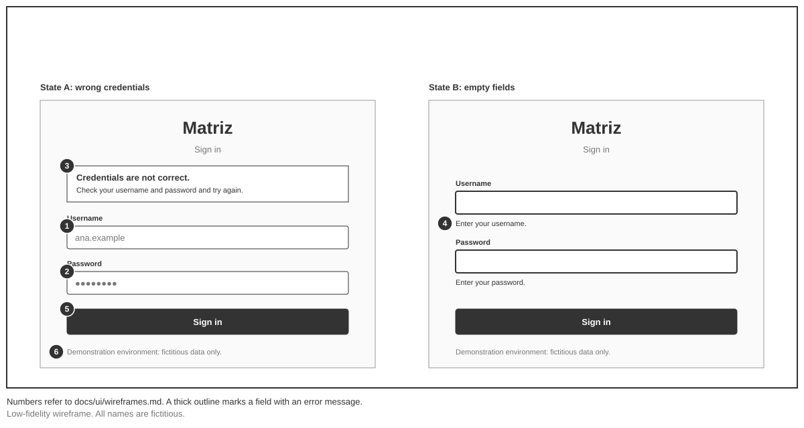
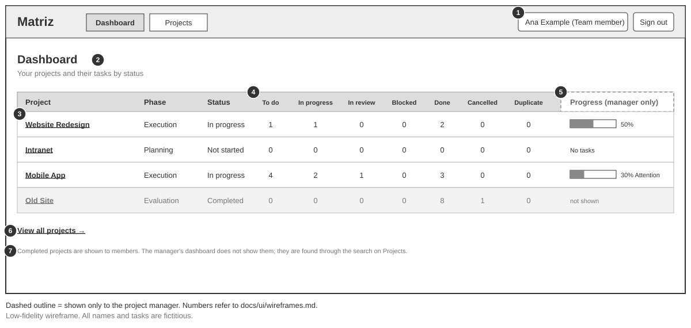
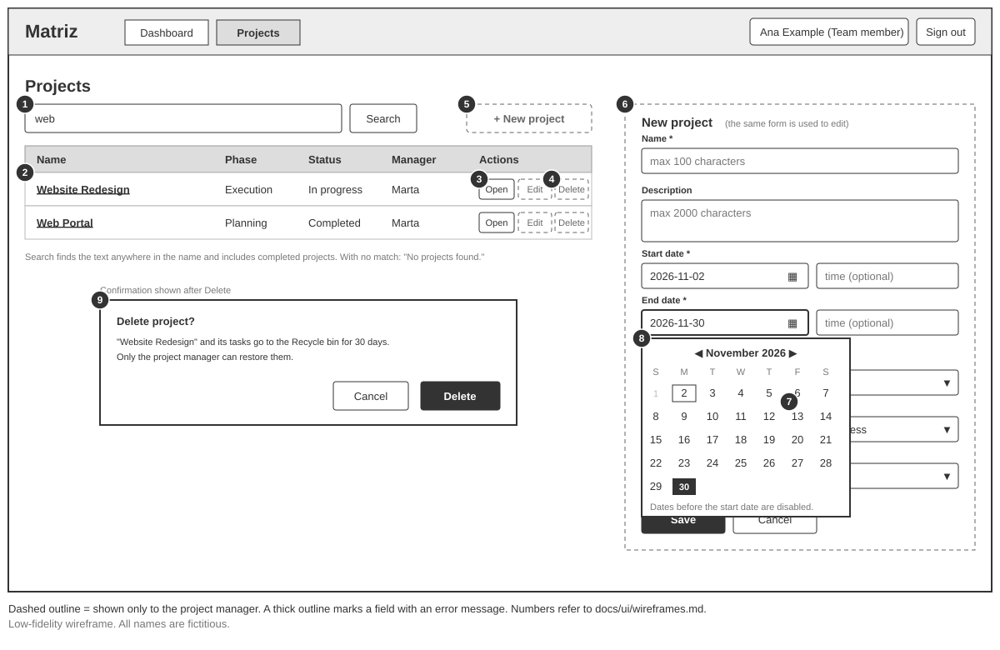
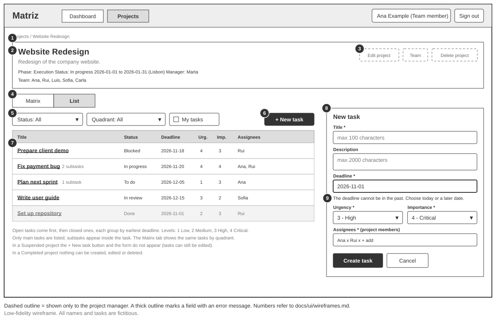
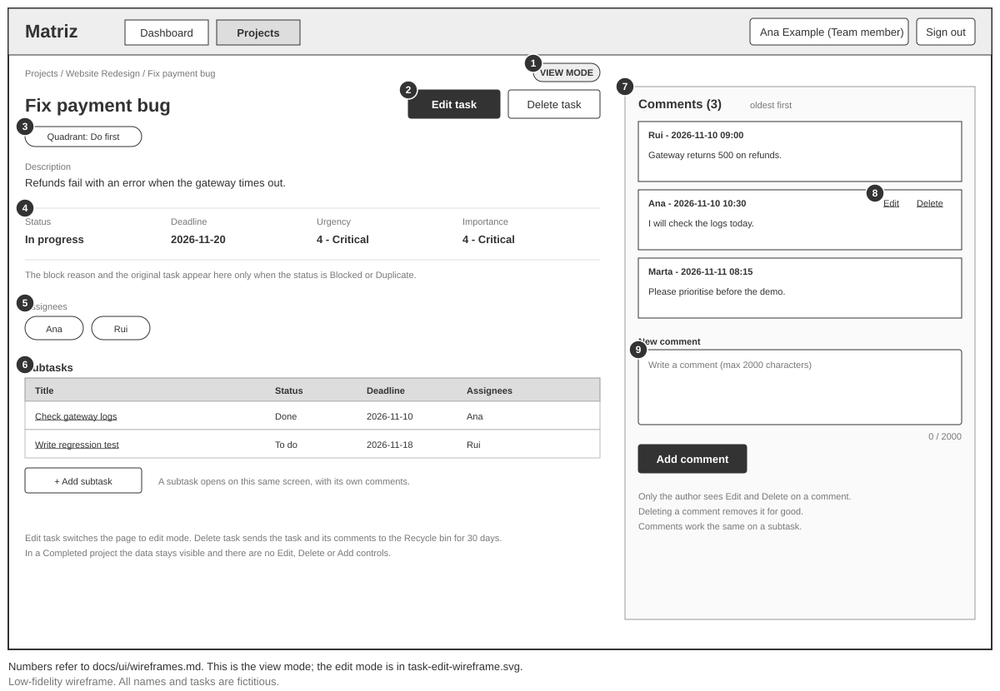

# Matriz — Wireframes dos ecrãs

> Wireframes de baixa fidelidade de cinco ecrãs da v1: início de sessão, painel inicial, projetos, detalhe do projeto e detalhe da tarefa. Não definem estilo visual nem tecnologia. O ecrã Matrix está em [matrix-wireframe.md](matrix-wireframe.md).
> Documentos relacionados: [requirements.md](../requirements.md), [user-stories.md](../user-stories.md) e [constraints.md](../constraints.md).

**Como foram gerados:** desenhados com IA (Claude) a partir dos documentos deste repositório, em SVG, sem cores nem estilo. Os rótulos estão em inglês, como a interface (NF01). Os nomes e as tarefas são fictícios (C8). Os números de cada desenho correspondem às tabelas de elementos. Os elementos de contorno tracejado só aparecem ao gestor do projeto, ou só em certos casos, como indicado em cada ecrã.

**Barra superior comum:** logótipo *Matriz*, ligações *Dashboard* e *Projects*, o utilizador autenticado com o seu papel e o botão *Sign out*. Só o ecrã de início de sessão não a tem.

## 1. Início de sessão (F10, US10)

Ficheiro: [sign-in-wireframe.svg](sign-in-wireframe.svg). Mostra dois estados: credenciais incorretas e campos vazios.

| # | Elemento | O que mostra | Origem |
|---|---|---|---|
| 1 | Campo *Username* | Nome de utilizador da conta de demonstração | F10, M11 |
| 2 | Campo *Password* | Palavra-passe, escondida ao escrever | F10, S5 |
| 3 | Mensagem de credenciais incorretas | "Credentials are not correct", sem dizer qual dos dois dados falhou, e o que fazer | Cenário 10.2, NF08 |
| 4 | Mensagem de campo vazio | Por baixo do campo em falta: "Enter your username." ou "Enter your password." | NF08 |
| 5 | Botão *Sign in* | Inicia a sessão e abre o painel inicial | Cenário 10.1 |
| 6 | Aviso de ambiente de demonstração | Só dados fictícios | C8 |

| De | Ação | Para |
|---|---|---|
| Início de sessão | Credenciais corretas | Painel inicial (cenário 10.1) |
| Qualquer ecrã sem sessão | Abrir uma ligação direta | Início de sessão (cenário 10.5, EC31) |
| Qualquer ecrã | *Sign out* | Início de sessão (cenário 10.4) |

Não há ligações de registo nem de recuperação de palavra-passe: são extensões opcionais, fora do MVP.

## 2. Painel inicial (F07, US13)

Ficheiro: [dashboard-wireframe.svg](dashboard-wireframe.svg).

| # | Elemento | O que mostra | Origem |
|---|---|---|---|
| 1 | Utilizador autenticado e *Sign out* | Nome e papel de quem tem a sessão iniciada | F10, US10 |
| 2 | Título | "Dashboard" | F07 |
| 3 | Nome do projeto | Ligação para o detalhe do projeto. Só aparecem os projetos acessíveis ao utilizador | Cenários 13.2 e 13.3, R8 |
| 4 | Contagens por estado | Número de tarefas principais em cada um dos 7 estados | Cenários 13.1 e 13.4, R18, P27 |
| 5 | Coluna *Progress* (só gestor) | Barra de progresso e estado calculado ("Attention" ou "Late"). Projeto sem tarefas mostra "No tasks" | US06, P5, P16 |
| 6 | *View all projects* | Abre a lista de projetos | F22 |
| 7 | Projetos concluídos | O membro vê-os; o painel do gestor não os mostra e ele encontra-os pela pesquisa | Cenário 13.5, P27 |

| De | Ação | Para |
|---|---|---|
| Painel | Nome do projeto (3) | Detalhe do projeto (cenário 13.3) |
| Painel | *View all projects* (6) ou *Projects* | Projetos |

## 3. Projetos (F01, F09, F22; US01, US12)

Ficheiro: [projects-wireframe.svg](projects-wireframe.svg). Mostra a pesquisa "web", o formulário de criação e edição e a confirmação de eliminar.

| # | Elemento | O que mostra | Origem |
|---|---|---|---|
| 1 | Pesquisa | Campo e botão *Search*. Procura em qualquer parte do nome, sem distinguir maiúsculas, e inclui os concluídos. Sem resultados: "No projects found." | F22, R25, P29, cenários 12.1 a 12.3 |
| 2 | Lista | Nome, fase, estado e gestor dos projetos acessíveis | R8, R19 |
| 3 | *Open* | Abre o detalhe do projeto | US13 |
| 4 | *Edit* e *Delete* (só gestor) | Editar abre o formulário; eliminar abre a confirmação | F01, R9 |
| 5 | *+ New project* (só gestor) | Abre o formulário de criação | F01 |
| 6 | Formulário (só gestor) | Nome (máx. 100), descrição (máx. 2000), datas de início e de fim com hora opcional, fuso horário (por defeito Lisboa), fase, estado e gestor. É o mesmo para criar e editar | F01, R14, R16, R19, P26 |
| 7 | Estado | Só os estados que o gestor define: *Not started*, *In progress*, *Suspended* e *Completed*. *Attention* e *Late* não se escolhem | R12, EC27 |
| 8 | Mensagem de validação | "The end must be after the start", por baixo da data de fim | R16, cenário 1.10 |
| 9 | Confirmação de eliminar | O projeto e as suas tarefas vão para a reciclagem durante 30 dias, e só o gestor os recupera | R9, R20, cenário 7.1 |

| De | Ação | Para |
|---|---|---|
| Projetos | *Open* ou nome do projeto | Detalhe do projeto |
| Projetos (gestor) | *Save* | Lista, com o projeto criado ou alterado |
| Projetos (gestor) | *Delete* confirmado | Lista, sem o projeto; o projeto fica na reciclagem |

## 4. Detalhe do projeto (F01, F02, F05, F22; US01, US02, US09, US12)

Ficheiro: [project-detail-wireframe.svg](project-detail-wireframe.svg). Mostra o separador *List*; o separador *Matrix* é o ecrã de [matrix-wireframe.md](matrix-wireframe.md).

| # | Elemento | O que mostra | Origem |
|---|---|---|---|
| 1 | Caminho | *Projects / nome do projeto* | Navegação |
| 2 | Dados do projeto | Nome, descrição, fase, estado, datas com fuso horário, gestor e equipa | F01 |
| 3 | *Edit project*, *Team* e *Delete project* (só gestor) | Editar os dados, adicionar e remover membros, e eliminar | F01, R9, R11, R17 |
| 4 | Separadores *Matrix* e *List* | *List* está ativo | F04, F05 |
| 5 | Filtros | Por estado, por quadrante (a "prioridade") e *My tasks*. Combinam-se | F22, R25, P29, cenários 12.4 a 12.6 |
| 6 | *+ New task* | Abre o formulário de nova tarefa. Não aparece num projeto suspenso ou concluído | R22, cenário 2.10 |
| 7 | Tabela de tarefas | Título (ligação para o detalhe da tarefa), número de subtarefas, estado, prazo, urgência, importância e responsáveis. As em aberto vêm primeiro; cada grupo por prazo mais próximo. Só tarefas principais | F05, R15, R18, R23, cenários 9.2 e 9.5 |
| 8 | Formulário de nova tarefa | Título, descrição, prazo, urgência, importância e responsáveis, escolhidos entre os membros do projeto | F02, F03, R1, R14, R21, R26 |
| 9 | Mensagem de validação | Por exemplo "The deadline cannot be in the past. Choose today or a later date." | R13, cenário 2.4, NF08 |

Num projeto **suspenso**, as tarefas editam-se, mudam de estado e apagam-se, mas o botão *+ New task* não aparece. Num projeto **concluído** não há nenhum controlo de criar, editar ou apagar (R22 e R27).

| De | Ação | Para |
|---|---|---|
| Detalhe do projeto | Título da tarefa (7) | Detalhe da tarefa |
| Detalhe do projeto | Separador *Matrix* (4) | Matrix do projeto |
| Detalhe do projeto | *Create task* (8) | Tabela, com a tarefa criada no estado "To do" |
| Detalhe do projeto (gestor) | *Edit project* (3) | Formulário do projeto (ecrã Projetos) |

## 5. Detalhe da tarefa (F02, F03, F08, F17; US02, US04, US11)

Ficheiro: [task-detail-wireframe.svg](task-detail-wireframe.svg). Uma subtarefa abre-se neste mesmo ecrã.

| # | Elemento | O que mostra | Origem |
|---|---|---|---|
| 1 | Título e quadrante | Título editável (máx. 100) e o quadrante calculado a partir da urgência e da importância | F02, F03, R14, R25 |
| 2 | Descrição | Editável (máx. 2000) | R14 |
| 3 | Estado, prazo, urgência e importância | Editáveis. O prazo segue R2, R3 e R13. Reabrir uma tarefa em estado final só o gestor | F02, F03, R2, R3, R13, P8 |
| 4 | Motivo de bloqueio e tarefa original | Só aparecem em *Blocked* (máx. 100) e em *Duplicate* (do mesmo projeto, diferente e não duplicada) | R6, R14 |
| 5 | Responsáveis | Podem ser vários, escolhidos entre os membros; remover o último é recusado | R21, R26, cenário 2.11 |
| 6 | Subtarefas | Estado, prazo e responsáveis próprios, e *+ Add subtask* | F08, R2 a R5, US04 |
| 7 | *Save changes* e *Delete task* | Guardar as alterações; eliminar envia a tarefa para a reciclagem durante 30 dias. Uma tarefa-mãe com subtarefas em aberto não se apaga | R9, R20, cenário 7.4 |
| 8 | Comentários | Do mais antigo para o mais recente, com autor e data | F17, R24, cenário 11.2 |
| 9 | *Edit* e *Delete* do comentário | Só o autor os vê no seu comentário. Apagar elimina-o de vez | R24, cenário 11.6 |
| 10 | Novo comentário | Texto de até 2000 caracteres e *Add comment* | R24, cenários 11.1 e 11.5 |

Num projeto **suspenso**, tudo isto é editável. Num projeto **concluído**, os dados e os comentários continuam visíveis, mas não há nenhum controlo para os alterar (R27, R24, cenários 2.13 e 11.10).

| De | Ação | Para |
|---|---|---|
| Detalhe da tarefa | Subtarefa (6) | Detalhe dessa subtarefa, com os seus comentários (cenário 11.8) |
| Detalhe da tarefa | *Delete task* (7) | Detalhe do projeto, sem a tarefa |
| Detalhe da tarefa | Caminho | Detalhe do projeto |

## 6. Validação face ao MVP

| Funcionalidade | Onde aparece |
|---|---|
| F01 Projetos e equipa | Projetos (lista, formulário), detalhe do projeto (dados e *Team*) |
| F02 e F03 Tarefas e prioridades | Detalhe do projeto (formulário), detalhe da tarefa |
| F04 Matriz | Separador *Matrix* ([matrix-wireframe.md](matrix-wireframe.md)) |
| F05 Lista | Detalhe do projeto, separador *List* |
| F06 Visibilidade | Só aparecem os projetos acessíveis; itens do gestor tracejados |
| F07 Painel inicial | Painel inicial |
| F08 Subtarefas | Detalhe da tarefa |
| F09 Reciclagem | Confirmações de eliminar. O ecrã da reciclagem ainda não tem wireframe |
| F10 Autenticação | Início de sessão e barra superior |
| F17 Comentários | Detalhe da tarefa |
| F22 Pesquisa e filtros | Pesquisa em Projetos; filtros no detalhe do projeto |

Os ecrãs não mostram nada da v2 nem da v3: sem etiquetas, lembretes, arquivo, auditoria, Calendário, anexos nem avisos externos. As ações cobrem as user stories US01 a US13, exceto a equipa (US01, parte) e a reciclagem (US07), que ainda não têm ecrã.

## 7. Pontos por confirmar

O código **W** é local aos wireframes e continua a numeração de [matrix-wireframe.md](matrix-wireframe.md).

| ID | Ponto | Proposta usada | Estado |
|---|---|---|---|
| W6 | Mensagens de campo vazio no início de sessão | "Enter your username." e "Enter your password." Os textos não estão definidos nos requisitos | Proposta |
| W7 | Forma do painel inicial | Uma tabela com uma linha por projeto e as 7 contagens por colunas | Proposta |
| W8 | Criar e editar projetos | O mesmo formulário, num painel ao lado da lista, e uma caixa de confirmação para eliminar | Proposta |
| W9 | Criar tarefa | Formulário num painel ao lado da tabela, em vez de uma página própria | Proposta |
| W10 | Editar uma tarefa | Todos os campos numa só página, com *Save changes* (sem gravação automática) | Proposta |
| W11 | Equipa e reciclagem | Ainda sem wireframe. Fica por decidir onde se acede à reciclagem (o wireframe Matrix tem *Recycle bin* por projeto, mas a reciclagem é do gestor e inclui projetos) | Por decidir |
| W12 | Alinhar o wireframe Matrix | Os ecrãs novos têm *Dashboard* e *Projects* na barra superior e um caminho em vez do seletor de projeto. O wireframe Matrix ainda tem o seletor de projeto e o separador *Dashboard* | Por decidir |
