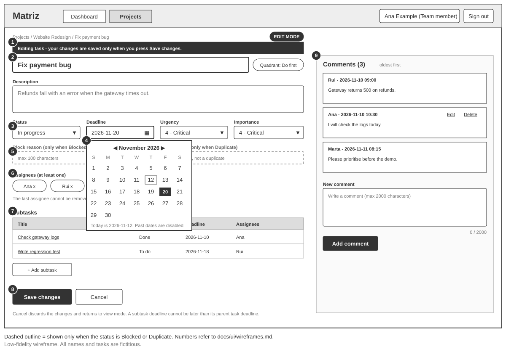
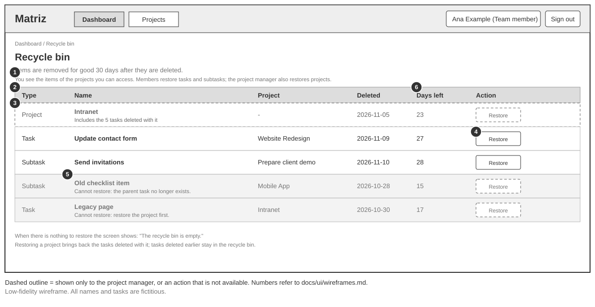

# Matriz — Wireframes dos ecrãs

> Wireframes de baixa fidelidade de sete ecrãs da v1: início de sessão, painel inicial, projetos, detalhe do projeto, detalhe da tarefa (modo ver e modo editar) e reciclagem. Não definem estilo visual nem tecnologia. O ecrã Matrix está em [matrix-wireframe.md](matrix-wireframe.md).
> Documentos relacionados: [requirements.md](../requirements.md), [user-stories.md](../user-stories.md) e [constraints.md](../constraints.md).

**Como foram gerados:** desenhados com IA (Claude) a partir dos documentos deste repositório, em SVG, sem cores nem estilo. Os rótulos estão em inglês, como a interface (NF01). Os nomes e as tarefas são fictícios (C8). Os números de cada desenho correspondem às tabelas de elementos. Os elementos de contorno tracejado só aparecem ao gestor do projeto, ou só em certos casos, como indicado em cada ecrã.

**Barra superior comum:** logótipo *Matriz*, ligações *Dashboard* e *Projects*, o utilizador autenticado com o seu papel e o botão *Sign out*. Só o ecrã de início de sessão não a tem.

## Seletor de data (componente comum)

Todos os campos de data usam um **calendário**. Nos wireframes aparece aberto no prazo da tarefa (detalhe do projeto e modo editar da tarefa) e na data de fim do projeto (projetos). O hoje dos desenhos é 2026-11-12.

| Campo | Datas disponíveis | Origem |
|---|---|---|
| Prazo de uma tarefa ou subtarefa | Só hoje e dias seguintes. As datas passadas aparecem desativadas | R13, cenários 2.4 e 2.7 |
| Data de início do projeto | Sem limite: um projeto pode começar no passado (como no cenário MVP-1) | R16 |
| Data de fim do projeto | Só a data de início e dias seguintes; as anteriores aparecem desativadas | R16, cenário 1.10 |

O servidor continua a validar as datas, porque um pedido pode não vir deste calendário (W13).

## 1. Início de sessão (F10, US10)

Ficheiro: [sign-in-wireframe.svg](sign-in-wireframe.svg). Mostra dois estados: credenciais incorretas e campos vazios.

| # | Elemento | O que mostra | Origem |
|---|---|---|---|
| 1 | Campo *Username* | Nome de utilizador da conta de demonstração | F10, M11 |
| 2 | Campo *Password* | Palavra-passe, escondida ao escrever | F10, S5 |
| 3 | Mensagem de credenciais incorretas | "Credentials are not correct", sem dizer qual dos dois dados falhou, e o que fazer | Cenário 10.2, NF08 |
| 4 | Mensagem de campo vazio | Por baixo do campo em falta: "Enter your username." ou "Enter your password." | NF08, W6 |
| 5 | Botão *Sign in* | Inicia a sessão e abre o painel inicial | Cenário 10.1 |
| 6 | Aviso de ambiente de demonstração | Só dados fictícios | C8 |

| De | Ação | Para |
|---|---|---|
| Início de sessão | Credenciais corretas | Painel inicial (cenário 10.1) |
| Qualquer ecrã sem sessão | Abrir uma ligação direta | Início de sessão (cenário 10.5, EC31) |
| Qualquer ecrã | *Sign out*, ou 3 horas sem atividade | Início de sessão (cenários 10.4 e 10.6) |

Não há ligações de registo nem de recuperação de palavra-passe: são extensões opcionais, fora do MVP.

## 2. Painel inicial (F07, US13)

Ficheiro: [dashboard-wireframe.svg](dashboard-wireframe.svg). Um cartão por projeto, com as contagens em mosaicos em vez de uma tabela larga (W7).

| # | Elemento | O que mostra | Origem |
|---|---|---|---|
| 1 | Utilizador autenticado e *Sign out* | Nome e papel de quem tem a sessão iniciada | F10, US10 |
| 2 | Título | "Dashboard" | F07 |
| 3 | Cartão do projeto | Nome (ligação para o detalhe), fase e estado. Só aparecem os projetos acessíveis ao utilizador | Cenários 13.2 e 13.3, R8 |
| 4 | Mosaicos de contagem | Um por estado da tarefa (7), com o número de tarefas principais. Os zeros também se mostram | Cenários 13.1 e 13.4, R18, P27 |
| 5 | *Progress* (só gestor) | Barra de progresso e estado calculado ("Attention" ou "Late"). Projeto sem tarefas mostra "No tasks" | US06, P5, P16 |
| 6 | *View all projects* | Abre a lista de projetos | F22 |
| 7 | Botão *Recycle bin* | Abre a reciclagem. Está no painel para todos os utilizadores | F09, R9 |
| 8 | Projeto concluído | O membro vê-o; o painel do gestor não o mostra e ele encontra-o pela pesquisa | Cenário 13.5, P27 |

| De | Ação | Para |
|---|---|---|
| Painel | Nome do projeto (3) | Detalhe do projeto (cenário 13.3) |
| Painel | *View all projects* (6) ou *Projects* | Projetos |
| Painel | *Recycle bin* (7) | Reciclagem |

## 3. Projetos (F01, F22; US01, US12)

Ficheiro: [projects-wireframe.svg](projects-wireframe.svg). Mostra a pesquisa "web", o formulário de criação e edição com o calendário aberto na data de fim, e a confirmação de eliminar.

| # | Elemento | O que mostra | Origem |
|---|---|---|---|
| 1 | Pesquisa | Campo e botão *Search*. Procura em qualquer parte do nome, sem distinguir maiúsculas, e inclui os concluídos. Sem resultados: "No projects found." | F22, R25, P29, cenários 12.1 a 12.3 |
| 2 | Lista | Nome, fase, estado e gestor dos projetos acessíveis | R8, R19 |
| 3 | *Open* | Abre o detalhe do projeto | US13 |
| 4 | *Edit* e *Delete* (só gestor) | Editar abre o formulário; eliminar abre a confirmação | F01, R9 |
| 5 | *+ New project* (só gestor) | Abre o formulário de criação | F01 |
| 6 | Formulário (só gestor) | Nome (máx. 100), descrição (máx. 2000), datas de início e de fim com hora opcional, fuso horário (por defeito Lisboa), fase, estado e gestor. É o mesmo para criar e editar | F01, R14, R16, R19, P26 |
| 7 | Estado | Só os estados que o gestor define: *Not started*, *In progress*, *Suspended* e *Completed*. *Attention* e *Late* não se escolhem. Num projeto concluído o estado já não se altera | R12, R28, EC27, EC37 |
| 8 | Calendário da data de fim | Datas anteriores à data de início desativadas | R16, cenário 1.10 |
| 9 | Confirmação de eliminar | O projeto e as suas tarefas vão para a reciclagem durante 30 dias, e só o gestor os recupera | R9, R20, cenário 7.1 |

| De | Ação | Para |
|---|---|---|
| Projetos | *Open* ou nome do projeto | Detalhe do projeto |
| Projetos (gestor) | *Save* | Lista, com o projeto criado ou alterado |
| Projetos (gestor) | *Delete* confirmado | Lista, sem o projeto; o projeto fica na reciclagem |

## 4. Detalhe do projeto (F01, F02, F05, F22; US01, US02, US09, US12)

Ficheiro: [project-detail-wireframe.svg](project-detail-wireframe.svg). Mostra o separador *List* e o calendário aberto no prazo; o separador *Matrix* é o ecrã de [matrix-wireframe.md](matrix-wireframe.md).

| # | Elemento | O que mostra | Origem |
|---|---|---|---|
| 1 | Caminho | *Projects / nome do projeto* | Navegação |
| 2 | Dados do projeto | Nome, descrição, fase, estado, datas com fuso horário, gestor e equipa | F01 |
| 3 | *Edit project*, *Team* e *Delete project* (só gestor) | Editar os dados, adicionar e remover membros, e eliminar | F01, R9, R11, R17 |
| 4 | Separadores *Matrix* e *List* | *List* está ativo | F04, F05 |
| 5 | Filtros | Por estado, por quadrante (a "prioridade") e *My tasks*. Combinam-se | F22, R25, P29, cenários 12.4 a 12.6 |
| 6 | *+ New task* | Abre o formulário de nova tarefa. Não aparece num projeto suspenso ou concluído | R22, cenário 2.10 |
| 7 | Tabela de tarefas | Título (ligação para o detalhe da tarefa), número de subtarefas, estado, prazo, urgência, importância e responsáveis. As em aberto vêm primeiro; cada grupo por prazo mais próximo. Só tarefas principais | F05, R15, R18, R23, cenários 9.2 e 9.5 |
| 8 | Formulário de nova tarefa | Título, descrição, prazo, urgência, importância e responsáveis, escolhidos entre os membros do projeto | F02, F03, R1, R14, R21, R26 |
| 9 | Calendário do prazo | Só hoje e dias seguintes; as datas passadas aparecem desativadas | R13, cenário 2.4 |

Num projeto **suspenso**, as tarefas editam-se, mudam de estado e apagam-se, mas o botão *+ New task* não aparece. Num projeto **concluído** não há nenhum controlo de criar, editar ou apagar (R22 e R27).

| De | Ação | Para |
|---|---|---|
| Detalhe do projeto | Título da tarefa (7) | Detalhe da tarefa, em modo ver |
| Detalhe do projeto | Separador *Matrix* (4) | Matrix do projeto |
| Detalhe do projeto | *Create task* (8) | Tabela, com a tarefa criada no estado "To do" |
| Detalhe do projeto (gestor) | *Edit project* (3) | Formulário do projeto (ecrã Projetos) |

## 5. Detalhe da tarefa, modo ver (F02, F03, F08, F17; US02, US04, US11)

Ficheiro: [task-detail-wireframe.svg](task-detail-wireframe.svg). O ecrã abre sempre em **modo ver**: os dados são texto, sem campos. Uma subtarefa abre-se neste mesmo ecrã.

| # | Elemento | O que mostra | Origem |
|---|---|---|---|
| 1 | Etiqueta *VIEW MODE* | Indica que a página está só para leitura | W10 |
| 2 | *Edit task* e *Delete task* | *Edit task* passa para o modo editar. *Delete task* pede confirmação e envia a tarefa para a reciclagem durante 30 dias. Uma tarefa-mãe com subtarefas em aberto não se apaga | R9, R20, cenário 7.4 |
| 3 | Título e quadrante | Título e o quadrante calculado a partir da urgência e da importância | F02, F03, R25 |
| 4 | Dados | Descrição, estado, prazo, urgência e importância. Motivo de bloqueio e tarefa original aparecem aqui só em *Blocked* e em *Duplicate* | F02, F03, R6 |
| 5 | Responsáveis | Lista dos responsáveis | R21, R26 |
| 6 | Subtarefas | Estado, prazo e responsáveis de cada uma, e *+ Add subtask* | F08, US04 |
| 7 | Comentários | Do mais antigo para o mais recente, com autor e data | F17, R24, cenário 11.2 |
| 8 | *Edit* e *Delete* do comentário | Só o autor os vê no seu comentário. Apagar elimina-o de vez | R24, cenário 11.6 |
| 9 | Novo comentário | Texto de até 2000 caracteres e *Add comment*. Os comentários funcionam também numa subtarefa | R24, cenários 11.1, 11.5 e 11.8 |

Num projeto **suspenso**, *Edit task* e *Delete task* estão disponíveis. Num projeto **concluído**, os dados e os comentários continuam visíveis, mas não há nenhum controlo para os alterar (R27, R24, cenários 2.13 e 11.10).

## 6. Detalhe da tarefa, modo editar

Ficheiro: [task-edit-wireframe.svg](task-edit-wireframe.svg). O modo editar distingue-se do modo ver por uma barra escura no topo, pela etiqueta *EDIT MODE* e pelos campos com caixa.

| # | Elemento | O que mostra | Origem |
|---|---|---|---|
| 1 | Barra *Editing task* | "Your changes are saved only when you press Save changes." | W10 |
| 2 | Título e descrição | Editáveis (máx. 100 e 2000 caracteres) | F02, R14 |
| 3 | Estado, urgência e importância | Listas de escolha. Reabrir uma tarefa em estado final só o gestor | F02, F03, P8 |
| 4 | Calendário do prazo | Só hoje e dias seguintes. O prazo de uma subtarefa não pode ser posterior ao da tarefa-mãe | R2, R3, R13, W13 |
| 5 | Motivo de bloqueio e tarefa original | Só aparecem em *Blocked* (máx. 100) e em *Duplicate* (do mesmo projeto, diferente e não duplicada) | R6, R14 |
| 6 | Responsáveis | Podem ser vários, escolhidos entre os membros; remover o último é recusado | R21, R26, cenário 2.11 |
| 7 | Subtarefas | Mesma lista do modo ver, com *+ Add subtask* | F08, R2 a R5, US04 |
| 8 | *Save changes* e *Cancel* | Guardar volta ao modo ver com os dados alterados; cancelar descarta as alterações e volta ao modo ver | W10 |
| 9 | Comentários | Os comentários continuam disponíveis, como no modo ver | F17, R24 |

| De | Ação | Para |
|---|---|---|
| Modo ver | *Edit task* | Modo editar |
| Modo editar | *Save changes* ou *Cancel* | Modo ver |
| Modo ver | *Delete task* confirmado | Detalhe do projeto, sem a tarefa |
| Qualquer um | Subtarefa | Detalhe dessa subtarefa, com os seus comentários (cenário 11.8) |

## 7. Reciclagem (F09, US07)

Ficheiro: [recycle-bin-wireframe.svg](recycle-bin-wireframe.svg). Qualquer utilizador chega aqui pelo botão *Recycle bin* do painel inicial.

| # | Elemento | O que mostra | Origem |
|---|---|---|---|
| 1 | Informação | Os itens são eliminados de vez 30 dias depois de apagados. Cada um vê só os itens dos projetos a que tem acesso | R8, R9, R20 |
| 2 | Tipo | *Project*, *Task* ou *Subtask* | F09 |
| 3 | Linha de projeto (só gestor) | Projeto apagado, com o número de tarefas que foram apagadas com ele. Só o gestor vê e recupera projetos | R9, cenário 7.3 |
| 4 | *Restore* | Recupera o item para onde estava. O membro recupera tarefas e subtarefas dos seus projetos; o gestor recupera também projetos | R9, cenários 7.2 e 7.3 |
| 5 | *Restore* indisponível | Subtarefa cuja tarefa-mãe já foi eliminada de vez: "Cannot restore: the parent task no longer exists." | R9, cenário 7.8 |
| 6 | Dias restantes | Quanto falta para a eliminação definitiva | R20, cenário 7.6 |

Quando um projeto é recuperado, voltam as tarefas apagadas com ele; as apagadas antes continuam na reciclagem (cenário 7.7). Sem itens, o ecrã mostra "The recycle bin is empty."

| De | Ação | Para |
|---|---|---|
| Painel inicial | *Recycle bin* | Reciclagem |
| Reciclagem | *Restore* de uma tarefa | Reciclagem, sem o item; a tarefa volta ao seu projeto |
| Reciclagem | *Restore* de um projeto (gestor) | Reciclagem, sem o item; o projeto volta à lista |

## 8. Validação face ao MVP

| Funcionalidade | Onde aparece |
|---|---|
| F01 Projetos e equipa | Projetos (lista, formulário), detalhe do projeto (dados e *Team*) |
| F02 e F03 Tarefas e prioridades | Detalhe do projeto (formulário), detalhe da tarefa (ver e editar) |
| F04 Matriz | Separador *Matrix* ([matrix-wireframe.md](matrix-wireframe.md)) |
| F05 Lista | Detalhe do projeto, separador *List* |
| F06 Visibilidade | Só aparecem os projetos acessíveis; itens do gestor tracejados |
| F07 Painel inicial | Painel inicial |
| F08 Subtarefas | Detalhe da tarefa |
| F09 Reciclagem | Reciclagem e confirmações de eliminar |
| F10 Autenticação | Início de sessão e barra superior |
| F17 Comentários | Detalhe da tarefa |
| F22 Pesquisa e filtros | Pesquisa em Projetos; filtros no detalhe do projeto |

Os ecrãs não mostram nada da v2 nem da v3: sem etiquetas, lembretes, arquivo, auditoria, Calendário (a vista), anexos nem avisos externos. As ações cobrem as user stories US01 a US13, exceto a gestão da equipa (US01, parte), que ainda não tem ecrã próprio (W11).

## 9. Pontos por confirmar

O código **W** é local aos wireframes e continua a numeração de [matrix-wireframe.md](matrix-wireframe.md).

| ID | Ponto | Proposta usada | Estado |
|---|---|---|---|
| W6 | Mensagens de campo vazio no início de sessão | "Enter your username." e "Enter your password." | Confirmado |
| W7 | Forma do painel inicial | Um cartão por projeto, com 7 mosaicos de contagem, em vez de uma tabela com muitas colunas. Substitui a primeira versão | Proposta (revista) |
| W8 | Criar e editar projetos | O mesmo formulário, num painel ao lado da lista, e uma caixa de confirmação para eliminar | Confirmado |
| W9 | Criar tarefa | Formulário num painel ao lado da tabela | Confirmado |
| W10 | Editar uma tarefa | Modo ver e modo editar separados, com etiqueta, barra *Editing task*, *Save changes* e *Cancel* | Confirmado, com a nota de distinguir ver de editar |
| W11 | Equipa e reciclagem | Reciclagem: wireframe feito e acessível a todos pelo painel. Equipa (adicionar e remover membros): ainda sem wireframe | Reciclagem decidida; equipa por decidir |
| W12 | Alinhar o wireframe Matrix com os restantes ecrãs | O wireframe Matrix ainda tem o seletor de projeto, o separador *Dashboard* e *Recycle bin* por projeto. Proposta: ser o separador *Matrix* do detalhe do projeto, com a mesma barra superior, caminho e cabeçalho | Por decidir |
| W13 | Regras do calendário nas datas do projeto e das subtarefas | Início do projeto sem limite; fim do projeto não anterior ao início; prazo de subtarefa não posterior ao da mãe (R2); prazo da mãe não anterior ao de uma subtarefa (R3) | Proposta |
| W14 | Tarefa cujo projeto está na reciclagem | Só se recupera depois de o projeto ser recuperado ("Cannot restore: restore the project first.") | Proposta |
